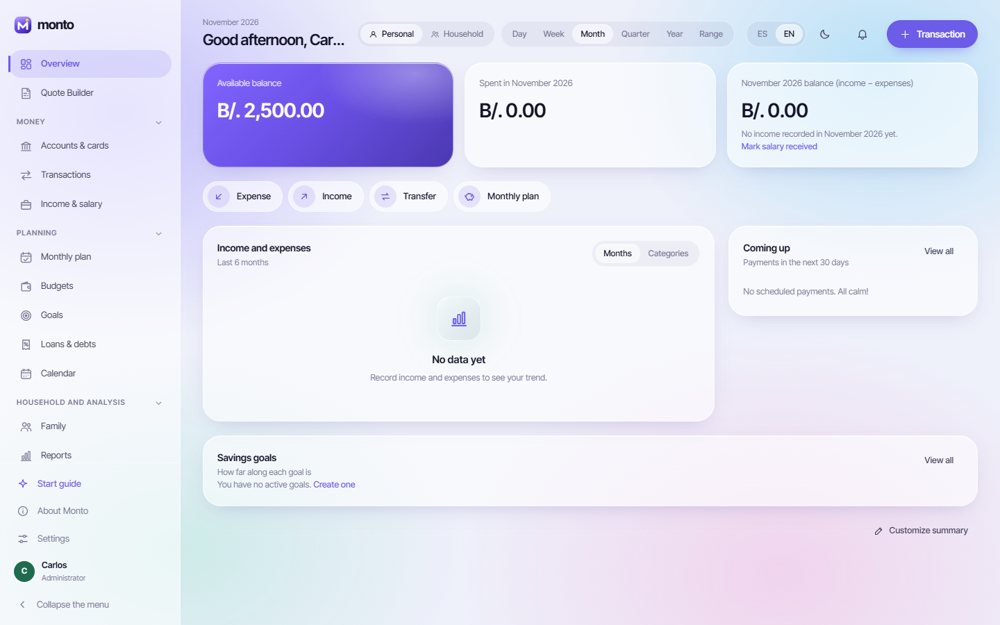

# Monto v1.0.2.1a — Confianza

## What's new

- **Monthly plans.** Monto opens the current month. Browse past and upcoming months, edit bills and track payments separately for each month.
- **A clearer sidebar.** Money and Planning groups bring related pages together. An active indicator stays visible in compact mode. New icons identify Transactions, Monthly Plan and Quotes.
- **Transaction feedback.** Monto confirms the save and briefly highlights the new row.
- **Profile controls.** Rename profiles, protect them with a six-digit PIN, or remove them from profile settings.
- **Panama tools.** Estimate salary and thirteenth-month pay. Create ACH quotes with hourly, daily or per-unit pricing, record approval and issue a receipt after payment.

Screenshots use fictional demo data.

## Install or update

Download [Monto_1.0.2.1a_x64.zip](https://github.com/eperez98/monto/releases/download/v1.0.2.1a/Monto_1.0.2.1a_x64.zip), extract it and run the included setup on Windows 10 or 11. The ZIP includes SHA256SUMS.txt. Existing users can also check for updates in **Settings → Updates**.
